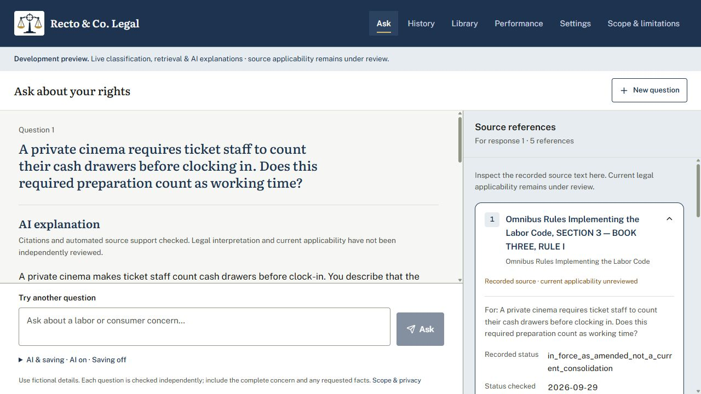
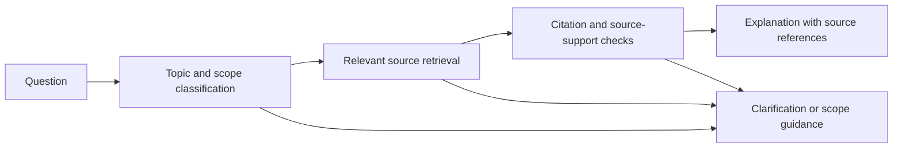

<p align="center">
  
</p>

<h1 align="center">Recto & Co. Legal</h1>

<p align="center"><strong>Accessible Philippine labor and consumer rights information.</strong></p>

<p align="center">
  <a href="#features">Features</a> ·
  <a href="#scope">Scope</a> ·
  <a href="#getting-started">Getting started</a> ·
  <a href="#documentation">Documentation</a>
</p>

Recto & Co. Legal is a web-based intelligent agent that helps Filipino workers and consumers understand everyday rights-related concerns. Users can ask questions in English or conversational Taglish, receive an explanation connected to their situation, and inspect the recorded legal provisions behind the response.

The project brings together a trained topic classifier, legal-source retrieval, citation checks and optional AI explanations in one accessible question-and-answer workspace. It was developed for **CS 403 — Intelligent Agents** at the **Technological Institute of the Philippines, Quezon City**.



## About the project

Finding a legal provision is only part of understanding a concern. A person also needs to know whether it addresses their situation, what conditions matter, and where the system's knowledge ends.

Recto focuses on selected Philippine private-sector labor and ordinary consumer concerns. Its agent coordinates question classification, scope handling, source retrieval and response checks. The interface keeps explanations close to their evidence so users can read the answer and examine its basis.

## Features

| Feature | What it offers |
| --- | --- |
| **Situation-specific responses** | AI explanations connect relevant source rules to the facts described in the question. When a legal explanation is unavailable, a separate AI response can explain the limitation or ask for a needed detail. |
| **Topic and scope recognition** | Identifies labor, consumer, mixed and outside-scope questions, including supported and excluded parts of the same submission. |
| **Inspectable citations** | Citation controls open complete stored provisions and highlight the exact passages used in the response. |
| **Legal-source library** | Browse the recorded collection, source details and use restrictions independently of a question. |
| **Reading accessibility** | Adjustable text size, high contrast, keyboard controls, reduced-motion support and responsive source navigation. |
| **Optional local history** | Choose which questions to save, then reopen, export or delete them. Saving is off by default. |
| **Local-only mode** | Turn AI off to use local classification, source retrieval and identified local responses. |
| **Performance reporting** | Inspect recorded classifier and retrieval evaluation results, with their methods and limitations. |

## Scope

| Domain | Selected topics |
| --- | --- |
| **Private-sector labor** | Wages and wage payment; working hours; rest days; overtime; holiday and premium pay; thirteenth-month pay; basic employment contracts; termination and due process; final pay and certificates of employment; complaint procedures and referrals. |
| **Consumer protection** | Defective products; warranties; repair, replacement and refund concerns; deceptive sales and misleading advertisements; displayed prices; product safety; basic service complaints; ordinary online consumer transactions; complaint procedures and referrals. |

Specialized matters such as government or overseas employment, banking, insurance, telecommunications, privacy, real estate and criminal investigations are outside the selected modules. Exact regional wage amounts and predictions about winning a case are also excluded. A mixed question can receive a response for its supported parts while the other parts are identified separately.

See the [complete project scope](project_legal_scope.md) for the full boundaries.

## How it works



Classification and retrieval run locally. With AI enabled, Together.ai can help interpret unclear wording and generate a response. Legal explanations select evidence from the supplied collection and undergo citation and automated support checks before display. Clarification and limitation responses use a separate factual-context check.

When AI is disabled, unavailable or unable to produce an accepted response, the application provides an identified local response. It does not present a failed draft as a successful AI explanation.

## Getting started

### Requirements

- **Windows**, which the local launcher and encrypted history currently support.
- **Python 3.12** with the `py` launcher.
- **Node.js 24** with npm, and **Git**.
- Internet access for the first dependency and public embedding-model download. AI features additionally require your own Together.ai API key.

### Install and run

Open a PowerShell terminal:

```powershell
git clone https://github.com/IvanDaHackerz/ia-recto.git
cd ia-recto
.\setup-project.ps1 -DownloadEmbeddingModel
.\start-website.ps1
```

Open the URL printed by the launcher, usually `http://127.0.0.1:5173`. Keep the terminal open while using the website; **Ctrl+C** stops that session. Run setup once for a new clone. For later sessions, run only `start-website.ps1`.

### Enable AI responses

Stop the website, configure your own key through the hidden prompt, then restart:

```powershell
.\.venv-item10\Scripts\python.exe -m backend.normalizer_credentials
.\start-website.ps1
```

Keep **Use AI explanations** on in the question options. Credentials are stored locally using Windows-user encryption and are excluded from Git. The application can also run with AI off; external AI use is subject to your provider account and usage limits.

For updates, troubleshooting and recovery, see the [installation and sharing guide](GITHUB_SHARING.md) and [setup and recovery documentation](DEPLOYMENT_AND_RECOVERY.md).

## Using Recto

1. Enter a complete concern in English or conversational Taglish.
2. Press **Enter** or click **Ask**. Use **Shift+Enter** for a new line.
3. Read the response and open its citations to inspect the supporting text.
4. If a detail is requested, include it with the original concern when asking again. Each submission is checked independently.
5. Enable saving only if you want to revisit the question in History.

Questions to try:

> A private cinema requires ticket staff to count their cash drawers before clocking in. Does this required preparation count as working time?

> Bumili ako ng defective appliance sa shop, pero ayaw nilang tanggapin ang warranty claim ko. Anong conditions ang dapat kong tingnan?

> My private employer delayed my salary. Separately, a retailer sold me a faulty kettle. Can you explain each concern?

## Technology

| Layer | Main technologies |
| --- | --- |
| Web interface | React, TypeScript, Vite, Radix UI and Lucide |
| Local application and API | Python |
| Classification | scikit-learn logistic regression with word and character TF-IDF features and explicit scope rules |
| Legal-source retrieval | Curated, versioned source records and BM25 retrieval in the current application |
| AI responses | Together.ai with structured output, citation validation and automated checks |
| Saved history | SQLite with Windows-user DPAPI encryption |
| Verification | Python unittest, Vitest, Testing Library, axe-core, lint and production-build checks |

## Responsible use and project status

Recto is an **academic prototype for general legal information**, not professional legal advice or a prediction of a case outcome. Its source collection is limited, and recorded source dates do not establish current legal applicability. Automated citation and support checks do not replace independent legal review.

The repository contains a working local application and recorded development evaluations. Independent human evaluation, legal-professional review and public deployment remain separate milestones; synthetic development results should not be read as real-world legal-answer accuracy.

Use fictional examples when trying the system. With AI enabled, the question and relevant context may be sent to Together.ai after best-effort local identifier masking. Saved history is optional and retained locally for 30 days. See the in-app **Scope & limitations** page for processing and storage details.

## Documentation

| Resource | Contents |
| --- | --- |
| [Project proposal](paper.md) | Research background, objectives and intended beneficiaries |
| [Project scope](project_legal_scope.md) | Included topics and exclusions |
| [Installation and sharing](GITHUB_SHARING.md) | Clone, update and run instructions |
| [Application documentation](backend/application/README.md) | API, response pipeline and operating controls |
| [Setup and recovery](DEPLOYMENT_AND_RECOVERY.md) | Reproducing the environment and recovering local state |
| [Development history](docs/DEVELOPMENT_HISTORY.md) | Dated milestones and technical notes from the former README |

For the project's software checks, run `check-project.ps1` from the repository root.
