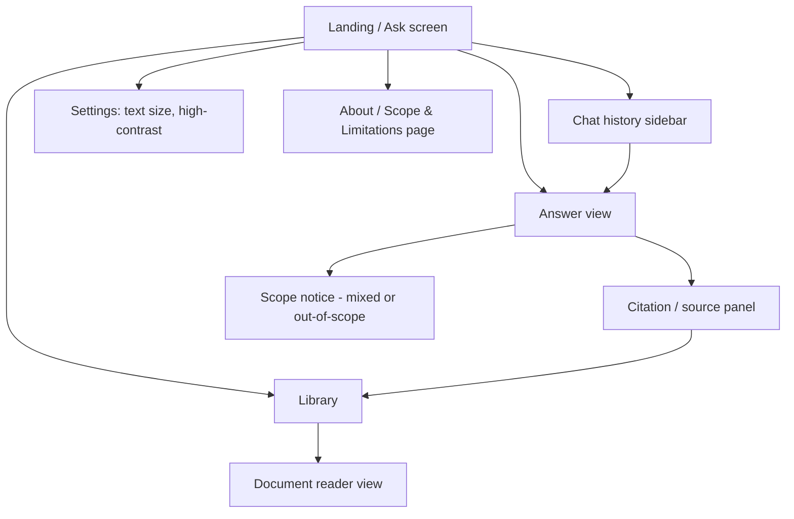

# UI Plan — Recto & Co. Legal

This plan translates [paper.md](../../paper.md), [project_legal_scope.md](../../project_legal_scope.md), and
[design_guide.md](./design_guide.md) into a concrete interface structure. It is a discussion
draft, not final visual design — the goal is to agree on *what screens/states exist and what
each must contain* before anyone touches color or pixels.

## Tech stack (prototype)

A working, sample-data-only prototype lives in [UI/UX/app](./app). Decisions:

- **React 18 + Vite + TypeScript** — component-based, matches the multi-screen/state structure below.
- **Tailwind CSS v4** — utility classes, but with a fully custom `@theme` (no default Tailwind palette). Tokens defined in [app/src/index.css](./app/src/index.css).
- **Radix UI Primitives** (unstyled: switch, toggle-group, tabs, accordion, dialog) — gives accessible, keyboard-friendly interactive components without imposing SaaS-kit visual defaults.
- **lucide-react** — minimal, neutral icon set (no decorative icons).
- **react-router-dom** — client-side routing across the six screens.
- **Local TypeScript data modules** ([app/src/data](./app/src/data)) — mock answers, citations, library documents, and history, standing in for a future API.
- **Self-hosted fonts via `@fontsource`**: [Literata](https://fonts.google.com/specimen/Literata) for reading content (serif, designed for long-form reading) and [Public Sans](https://public-sans.digital.gov/) for UI chrome (USWDS's government-service typeface — matches the "public service counter" register from the design guide).

Run it locally: `npm --prefix UI/UX/app run dev`.

---

## 1. What the product actually is (recap, so every screen decision traces back to it)

Recto & Co. Legal is a **goal-based intelligent agent**, not a generic chatbot, that answers
questions strictly within **Philippine labor law** and **consumer protection law** (see
[project_legal_scope.md](../../project_legal_scope.md) for the exact included/excluded topics).
For every question it must, per the proposal:

1. Classify the question's legal domain(s) — labor, consumer, mixed, or out-of-scope.
2. Retrieve supporting sections from the verified knowledge base.
3. Only answer if retrieval confidence clears a defined threshold — otherwise decline/refer.
4. Verify that any cited provision actually matches the retrieved text (no fabricated citations).
5. Surface known amendments/repeals and a "sources last checked" date.
6. For **mixed-domain** questions, answer the supported part and explicitly flag the unsupported part.
7. For **fully out-of-scope** questions, give a plain-language decline + referral (PAO/DOLE/DTI etc.), never a generic error.
8. Support saved chat history, adjustable text size, and a high-contrast mode (PWD accessibility, stated as non-negotiable in the proposal).

So the UI's core job is: **make the evidence trail (citations, verification, scope) as visible
and trustworthy as the answer itself.** That single sentence should be the tie-breaker for every
layout argument below.

---

## 2. Information architecture

Six surfaces total. No marketing homepage, no dashboard, no onboarding wizard — the query box
is the entry point, per the design guide ("the product's job starts the moment someone can type").
The Library is reachable both as its own nav item and as a "look this up yourself" jump target
from any citation card in the answer view.

---

## 3. Screen-by-screen breakdown

### 3.1 Landing / Ask screen
- **Hero element**: the question input. Large, plain, single field with a short helper line
  ("Ask about your rights as a worker or consumer in the Philippines.") — not a marketing headline.
- Below the fold (not competing with the input): 2–3 example questions users can click to
  populate the field (e.g., "Can my employer fire me without notice?", "The store won't honor
  my warranty — what are my rights?"). These double as an implicit scope hint without a wall of text.
- A quiet, permanent link/line to the **Scope & Limitations** page — this isn't a modal or
  interruption, just an honest disclosure always available (matches proposal's "scope and
  limitation notice" requirement).
- Persistent access to **chat history** (sidebar or drawer) and **settings** (text size /
  high-contrast toggle) — global chrome, present on every screen, not just this one.

### 3.2 Answer view
This is the reading interface, structured in two zones, side by side on desktop and stacked
on mobile:

**a. Plain-language answer (primary column)**
- Direct, calm answer in plain language by default.
- Explicit **domain tag** per response, but rendered as a quiet inline label, not a badge-kit
  chip — e.g., "This concerns: Labor" — not a colorful pill.
- If confidence is insufficient: the answer column shows a decline message instead of a
  partial/hedged answer — per objective, "avoid generating substantive claims when sufficient
  supporting evidence cannot be retrieved."
- If the question is **mixed-domain**: the answer column visibly splits into "What I can answer"
  and "Outside what I can answer" — two distinct blocks, not folded into one paragraph. This
  split is a core product behavior, not an edge case, so it needs a real layout treatment, not
  an afterthought banner.

**b. Citation / source panel (secondary column)**
- Persistent, not a collapsed accordion by default — proposal calls this "core structural
  content," and design guide says treat it like an annotated legal reference, not a chat feature.
- Each citation entry shows: source title + section/article number, a **verified** mark (ties to
  the amber/gold "verified" treatment from the design guide), the **sources-last-checked date**,
  and any known amendment/repeal flag.
- Clicking/expanding a citation reveals the exact quoted legal text, typographically distinct
  from the plain-language explanation (serif "quoted source" treatment vs. sans-serif UI chrome,
  per design guide).
- If citation verification fails or confidence is borderline, the panel should say so plainly
  rather than silently omitting it — trust requires showing the system's own uncertainty.

### 3.3 Out-of-scope / decline state
- Its own distinct visual treatment (per design guide: "deserves its own visual treatment, not
  just a grey error box... should read as helpful redirect, not failure").
- Content: plain statement that the topic is outside labor/consumer scope, followed by a
  concrete referral (PAO, DOLE, DTI, or other relevant office) when one applies.
- Never styled as a system error, never uses apologetic/alarmed language (no "Sorry!", no ⚠️).

### 3.4 Chat history
- Simple reverse-chronological list of past questions, each opening back into its full answer +
  citation-panel state (not just a plain-text log).
- Since sessions concern real personal disputes, this list should not visually resemble a
  generic "recent files" widget — quiet, text-first, dates in plain format.

### 3.5 Settings (accessibility)
- Text size control (small/medium/large or a stepped slider) — applies sitewide, persisted.
- High-contrast mode toggle — a genuine alternate palette meeting WCAG AA+, not just a CSS filter.
- Both must be reachable from every screen (header or persistent icon), not buried in a menu tree.

### 3.6 About / Scope & Limitations page
- States plainly what the system covers (see [project_legal_scope.md](../../project_legal_scope.md)
  include/exclude lists) and what it explicitly does not do: no legal advice, no case-outcome
  prediction, no coverage of excluded sub-topics (e.g., OFWs, kasambahay, insurance, real estate).
- This page is a trust artifact, not a legal disclaimer buried in a footer — link to it should be
  visible, not hidden in 8px grey text.

### 3.7 Library (manual search/browse)

**Feasibility check (rescanned the dataset for this):** yes, and there's already real content to
back it, in two distinct tiers that the UI must not blur together:

1. **Verified answer sources** — the curated set tracked in
   [canonical_documents.csv](../../dataset/canonical_sources/manifests/canonical_documents.csv),
   e.g. the DOLE 2022 Labor Code edition, PD 442, RA 7394 (Consumer Act), RA 6727, RA 10909,
   RA 11967, plus implementing rules/department orders/labor advisories. Each row already has
   exactly the metadata a library needs: `citation`, `title`, `document_type`, `issuer`,
   `approval_or_edition_date`, `verification_status`, `answer_eligible_candidate`, source URL,
   and `notes`. This is the same set the agent's citation panel draws from.
2. **Broader historical/discovery corpus** — the converted Markdown collection under
   [dataset/markdown/](../../dataset/markdown/): `acts/`, `ao/` (administrative orders),
   `bataspam/` (Batasang Pambansa), `comacts/` (Commonwealth acts), `consti/` (constitutions),
   `execord/` (executive orders), `genor/` (general orders), `juris/` (jurisprudence), `mc/`
   (memorandum circulars), `mo/` (memorandum orders), `presdecs/` (presidential decrees),
   `proc/` (proclamations), and `repacts/` (Republic Acts) — spanning roughly 1900 to 2025.
   This is the BetterGov.PH-derived corpus. Per the canonical-sources README, it is
   **secondary_reliable / retrieval_only**: useful for lookup, but "not independently sufficient
   for current legal status or final-answer authority."

Because of that split, the Library must **never present tier 2 as verified current law**. Every
result needs a visible, honest tier label — not a subtle icon that most users will miss.

**Layout**: a search-and-filter surface, not another card grid —
- A plain search field (full-text/citation search — e.g. typing "13th month pay" or "RA 7394"
  or "PD 442" should work).
- Filters as plain facets, not decorative chips: **Domain** (labor / consumer / general),
  **Document type** (republic act, presidential decree, executive order, administrative order,
  memorandum circular/order, proclamation, jurisprudence, constitution, etc.), **Year/date
  range**, and a **"Verified answer source only"** toggle for users who specifically want the
  documents the agent is actually allowed to answer from.
- Results as a plain list (title, citation, type, date, tier label), not cards with shadows —
  consistent with the design guide's instruction to structure by actual content hierarchy.
- Selecting a result opens a **document reader view**: the full Markdown/section text, quoted-
  source typographic treatment (same serif treatment as citation text in the answer view), with
  the tier banner and, for tier-1 documents, the same verification/last-checked/amendment-repeal
  metadata shown in the citation panel. For tier-2 documents, a plain note that the document is
  from the discovery corpus and its current legal status has not been separately verified.
- Deep-link from any citation card in the answer view straight into this reader ("View full
  text in Library") so the two features share one document-reading component instead of
  duplicating it.

---

## 4. Component inventory (shared building blocks)

| Component | Notes |
|---|---|
| Query input | Hero-level, generous padding, no placeholder-as-label anti-pattern |
| Answer block | Plain-language, active voice, no markdown-heavy formatting |
| Mixed-domain split block | Two clearly separated sub-sections within one answer |
| Citation card | Distinct from generic "content card" — legal-reference styling, not SaaS-card styling |
| Verified/last-checked marker | Amber/gold accent per design guide, used only for this state |
| Amendment/repeal flag | Distinct marker, separate from "verified," since it signals caution not confirmation |
| Out-of-scope/decline panel | Own color treatment, referral links, no error iconography |
| History list item | Text-first, no thumbnail/preview card styling |
| Domain tag | Quiet inline label ("Labor" / "Consumer" / "Mixed"), not a bright chip |
| Text-size control | Global, persistent |
| High-contrast toggle | Global, persistent, real alternate palette |
| Library search bar | Plain full-text/citation search, no autosuggest gimmicks |
| Library filter facets | Domain, document type, year range, verified-only toggle |
| Document reader | Shared by Library and citation-panel "view full text" links |
| Corpus tier label | Distinguishes verified answer sources from discovery-only corpus, on every result and reader view |

Explicitly **not** using: identical rounded card grids, badge/chip kits with bright fills for
every state, breadcrumb "eyebrow" labels, monospace data labels, arrow-suffixed buttons — all
flagged as slop patterns in the design guide.

---

## 5. Content states to design for (per response)

Every answer view must account for these, since they're explicit product behaviors from the
proposal, not exceptions:

1. **Fully supported answer** — labor or consumer, single domain, high confidence, citations verified.
2. **Mixed-domain answer** — part supported, part flagged out-of-scope, both shown together.
3. **Low-confidence / insufficient evidence** — decline to answer substantively, explain why, no guessing.
4. **Fully out-of-scope** — referral message, no attempted answer.
5. **Citation exists but verification uncertain** — shown honestly, not hidden.
6. **Known amendment/repeal on a cited provision** — flagged inline near that citation.
7. **Library document from the discovery corpus only** — full text is viewable, but the reader
   clearly states it is not a verified answer source and its current legal status is unconfirmed.

---

## 6. Accessibility checklist (non-negotiable, from design guide + proposal)

- Semantic HTML: real `<button>`, `<label>`, `<nav>`, heading hierarchy — no styled `
` controls.
- Visible focus outlines on every interactive element (input, citation toggles, history items, settings).
- WCAG AA contrast minimum across the whole palette, especially the accent/verified color and the decline-state color against background.
- `prefers-reduced-motion` respected — the design guide already scopes motion to one deliberate moment (response appearing), so this is low-risk to satisfy.
- Adjustable text size and high-contrast mode functional across all five screens, not just the answer view.

---

## 7. Open questions to settle before visual design starts

1. Desktop layout: fixed two-column (answer | citations) always visible, or citation panel
   collapsible on smaller desktop widths?
2. Mobile: citation panel as a below-the-fold section, or a pull-up sheet triggered from the answer?
3. History: sidebar (persistent) vs. drawer (toggled) — depends on how much horizontal space the
   two-column answer view needs.
4. Do domain tags need distinct colors per domain (labor vs. consumer), or should they stay
   monochrome to avoid drifting into "chip kit" territory?
5. How prominent should the "last checked" date be — inline per citation only, or also a global
   freshness indicator somewhere in the answer view?
6. Library scale: the discovery corpus spans ~1900–2025 across 13 document-type folders. Do we
   index/expose all of it at launch, or ship the Library scoped to labor/consumer-relevant
   material first and widen later, matching the phased "Item 4/5" expansion already described
   in the dataset README?

---

## 8. Next steps

1. Agree on answers to the open questions in §7.
2. Lock the color palette + type pairing per the design guide's Color/Typography sections
   (define actual hex values as a design-tokens file).
3. Low-fidelity wireframes for: landing, answer view (single-domain), answer view (mixed-domain),
   out-of-scope state, history, settings.
4. Build the first component in code: query input + answer view, since it's the critical path
   the rest of the UI depends on.
