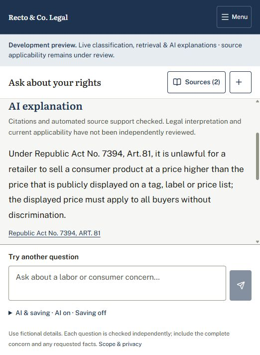

# Philippine scope and AI usability repair — 100 new questions

Completed 22 October 2026. The website now uses classifier v1.5.52, retrieval v1.3.43 and verifier v1.0.50. The API was restarted after final selection; its runtime signature matches the selected files. AI explanations are enabled in the development website. Public deployment and reviewed-legal-answer approval remain closed.

## What improved

The first full live run matched the frozen primary label on **92/100**, scope label on **92/100**, and route/domain expectations on **89/100**. After repairs the full live replay matched primary **99/100**, scope **100/100**, and route/domain **99/100**. Complete case checks improved from **88/100 to 99/100**. The final AI-off replay of all 100 retains those repaired results. Out-of-scope admissions fell from **4/25 to 0/25**.

The repaired primary macro-F1 is **0.9900** and scope macro-F1 **1.0000** on this reused development set. These scores describe topic/scope decisions, **not legal-answer accuracy**. They are not independent population estimates or proof that every new question will work.

The remaining mismatch is **PH2_057**: “private construction contract” does not establish employment and could mean a construction service. The original expected mixed/employment label is preserved. The system asks for clarification rather than discarding the uncertainty. See [expectation-review.json](expectation-review.json).

## Test design and provenance

- **100 unique fictional Philippine questions:** 25 labor, 25 consumer, 25 mixed, 25 outside scope. Mixed cases include fully supported, partly supported and three-concern situations. English and Taglish are represented.
- Frozen cases SHA-256: `3479a57d4d014776476467171754c505db801fa6738c9a6ace70b2dd2d190267`. Topic, scope, route and domain expectations were written before the initial run.
- All cases are **AI-authored development diagnostics; zero independent human questions**. No new source IDs were independently judged relevant before inference, so no new-100 retrieval accuracy is claimed.
- AI was enabled through the real `ApplicationService.chat(use_ai=True)` pipeline, using the configured Together GPT-OSS model. Bulk runs used two workers, no automatic transport retry, and a separate shared study ledger. At most one corrective generation was available per question; generation/support checks can each make calls.
- The five live phases contain **259 diagnostic executions of these 100 unique questions**, not 259 new questions. Replays and selected follow-ups were informed by observed failures. All raw results and rejected drafts remain in their original run folders.
- Three final website submissions checked the actual form, AI setting, displayed answer and citation navigation. Saving remained off. This supplements, rather than replaces, the service tests.

## Repairs implemented

**Concern handling and scope.** A scenario and its follow-up question stay together; attribution and complaint-process fragments keep their context. Independent actors remain separate. Private hotel/clinic employment, seasonal and probation concerns are recognized more consistently. Government employment, exact minimum-daily-wage requests, transport regulation and privacy-only requests retain their documented scope boundaries. Weak fragments cannot silently introduce or remove a category; ambiguous concerns ask for clarification. Common English words and inflections such as accounting, charging, role, proved and put are preserved by typing repair.

**Source selection.** Ranking distinguishes project/seasonal employment, closure, probation standards, religious rest-day preferences, counted working time, defective quality, safety, paid repair services, shelf-label prices, cash change, and internal platform redress. Dismissal procedure no longer overrides an unrelated wage/deduction question. These are concept/context changes; canonical source records remain byte-identical across retrieval versions 40–43.

**AI explanations.** Partial-scope prompts include only supported concerns, while the website still identifies excluded parts. Valid article/section names are accepted only when they match an actually cited source. Corrections start afresh with precise failure feedback. Conditional checks now catch observed errors involving money-claim limits, conciliation exceptions, authorized causes, project/seasonal definitions, ordinary-day overtime, product-remedy alternatives and subsidiary liability. The system still checks exact passages, numeric details, source identity, eligibility and entailment before displaying generated prose.

No learned heads, thresholds, training membership or calibration method were changed. Bundle metadata/version bytes changed; the learned objects compare equal. This was an inference, routing, retrieval and explanation repair, not retraining on these test questions. See [source-preservation.json](source-preservation.json).

## Live AI results, kept separate by revision

| Phase | Questions | Generated | Partly generated | Withheld | Median | p95 | Exact citation checks |
| --- | ---: | ---: | ---: | ---: | ---: | ---: | ---: |
| initial | 100 | 41 | 6 | 53 | 8.98s | 29.36s | 156 |
| repaired | 100 | 46 | 2 | 52 | 5.63s | 25.03s | 146 |
| final-targeted | 49 | 36 | 1 | 12 | 13.61s | 28.45s | 103 |
| feedback-targeted | 9 | 3 | 1 | 5 | 14.27s | 31.41s | 10 |
| overtime-final | 1 | 1 | 0 | 0 | 8.64s | 8.64s | 2 |

Every phase returned all its packets with zero application exceptions. Initial provider failures occurred on two questions; the full repaired replay had one incomplete provider response. The later 49-case, nine-case and one-case runs had no provider failures. A withheld excluded-scope response is expected; a withheld supported question is an unresolved usability limitation. Generated/withheld counts are **not correctness scores**. The selected runs have different difficulty and cannot establish a controlled speed improvement.

All **417 displayed citation checks** across the five phases passed exact-span, source-identity, domain and hold checks. This did not guarantee semantic correctness. Engineering reading found accepted bad interpretations, including “not an exception therefore casual,” a distorted seasonal/regular definition, AND instead of OR for immediate product remedies, and “ordinary-day rate” turned into an only-if overtime rule. Historical accepted texts remain preserved. Subsequent checks rejected the first patterns; the final overtime microcheck produced a correctly qualified ordinary-day statement. See [INITIAL_READING.md](INITIAL_READING.md), [TARGETED_READING.md](TARGETED_READING.md), and each run's `source-audit.json`.

The nine-case feedback replay generated three complete explanations and one partial explanation; **018, 022, 033, 048 and 059 remained withheld**. Case 008 then received a final targeted source-condition repair and successful live microcheck. Cases 047, 053 and 073 also lacked a successful complete explanation in their latest selected check. Case 060 answered the warranty component and explicitly retained the COE evidence gap. Other previously recorded source gaps remain; a successful label is not an assurance of an available legal answer.

The final 100-question classification replay uses the final stack with AI off. **There was no final uniform 100-question live AI rerun** after every last explanation change. Final live evidence is the disclosed selected rechecks plus three website checks. [latest-observations-summary.json](latest-observations-summary.json) indexes the last result for each question across revisions; it is not a uniform final-stack accuracy estimate.

The dedicated study ledger recorded **478 provider attempts**, estimated **$0.4668942**, within its 500-attempt/$0.50 cap. That estimate includes generation, support checks and corrective calls across the five phases; it is not verified billing. The three subsequent browser submissions used the separate website ledger. No credentials are included in the evidence.

## Regression and software verification

The final old 436-input AI-off regression is [local-pipeline-evaluation-v1.6.24](../local-pipeline-evaluation-v1.6.24/metrics.json). On its 425 labeled inputs, primary and scope matches are **425/425** with macro-F1 **1.0** each. Route/domain matches are **432/436**, with four retained historical clarification-policy mismatches. Unsupported admissions are **0/80**. For its 93 pre-judged retrieval queries, known-relevant Hit@1 is **68/93**, Hit@5 **93/93**, MRR@5 **0.8584**, and recall@5 **0.9570**. There were **1,539 candidate-integrity checks, zero failures**, and **423/423 recorded-excerpt checks**. These are reused development checks, with zero live AI calls and no independent human acceptance.

Final software checks passed: **260 backend tests**, **69 packaged classifier tests**, **29 classifier contrast tests**, **59 retrieval tests**, **37 verifier tests**, and **31 frontend tests**, plus frontend production build and lint. Test groups overlap; they are not separate labeled-question samples. Logs and [software-checks.json](software-checks.json) are retained. The selected performance data binding and its checksums point to the completed final local evaluation.

Final browser checks at `http://127.0.0.1:5174/`:

1. **079 government overtime:** scope referral, no AI legal explanation despite AI being on.
2. **062 government overtime plus defective rice cooker:** excluded government allegation; consumer explanation with Art. 100; clicking the citation opened the matching recorded source.
3. **035 shelf label versus counter price:** consumer response with Art. 81/83 candidates and a generated Art. 81 explanation. The details panel showed two LLM calls and 6,944 ms. AI stayed on, local saving stayed off, and no browser console errors were observed during these checks.

## Remaining limits before claiming defense readiness

- Supported questions can still receive source-only, partial, or withheld responses. The unresolved cases above need further evidence or generation work; withholding does not count as a successful explanation.
- Counted waiting/briefing time, meal-break details, final pay, COE, and the required related 13th-month authority have recorded evidence limitations. Known holiday-wording and employment-text continuity holds remain in effect. No source was marked current or legally reviewed to increase answer counts.
- Exact citations and a same-model support judge can still miss a misleading interpretation. Pattern guards address observed errors and are not a general proof of legal soundness. Independent legal/source review remains open.
- New unconstrained wording and heavy spelling noise need untouched evaluation. The current 100 cases were inspected and reused during repair; they cannot establish independent generalization or human-gold performance.
- Multi-call AI latency remains noticeable: selected hard cases can take tens of seconds. Provider response variation/timeouts remain possible.
- The four older clarification-policy differences, deployment approval and formal acceptance remain open. `all_project_issues_closed` remains false.

The website is more usable on these tested scope patterns and remains an explicitly labeled development preview. The next validation should use fresh, untouched questions and reviewed expected answers rather than polishing these same scores further.

## Evidence map

[summary.json](summary.json) contains the machine-readable comparison and final stack. [live-cases.json](live-cases.json) and [live-case-manifest.json](live-case-manifest.json) preserve the frozen inputs. Each phase contains its protocol, source snapshot, observations, provider completions, metrics and source audit. [browser-evidence.json](browser-evidence.json), [browser-checks.json](browser-checks.json), and [final-health.json](final-health.json) record the final website check. [final-checksums.json](final-checksums.json) hashes completed evidence; mutable API logs and open usage databases are excluded. Failed exploratory artifacts remain unselected and preserved.
