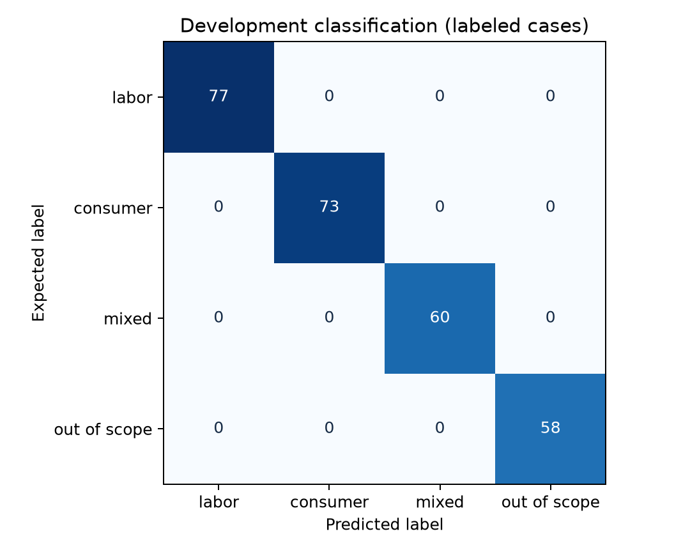
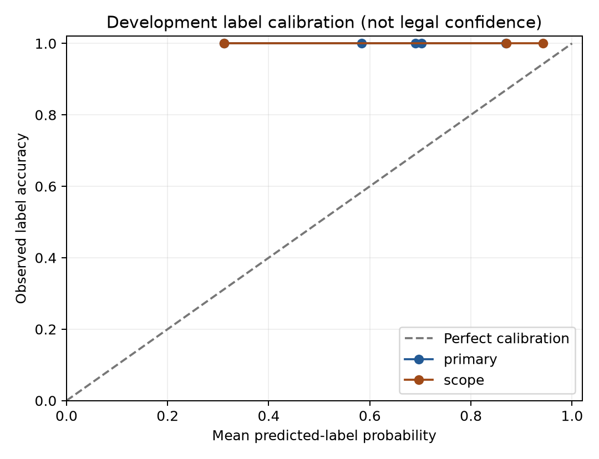

# Item 13 — offline system evaluation

The offline evaluator is implemented and executed on **291 AI-authored development cases**, with **34 software tests passing**. This implements the offline phase of Item 13. Formal independent acceptance and actual generated-answer evaluation remain pending.

The run freezes protocol, cases, grouping and code/source hashes before inference. The actual `outputs/item10-classifier-v1.5.5`, `outputs/item11-retrieval-v1.2.4` and `outputs/item12-verifier-v1.0.2` receive only question text; expected labels/domains/provision IDs are used afterward for scoring. No LLM calls, new model fitting, source promotion or deployment occurred.

## Data and results

The same 200 general/typing questions, 67 retrieval cases and 24 AI-authored system questions across eight three-variant families were used. A repair revision reuses the parent case bytes and screening targets unchanged. They cover supported/partially supported mixed concerns, exclusions, missing facts and corpus gaps. All material remains development; zero independent human questions were created.

| Suite | Cases | Labeled cases | Primary accuracy | Scope accuracy | Decisive coverage |
|---|---:|---:|---:|---:|---:|
| general | 100 | 100 | 100.0% | 100.0% | 92.0% |
| retrieval | 67 | 67 | 100.0% | 100.0% | 100.0% |
| system | 24 | 21 | 100.0% | 100.0% | 100.0% |
| typing | 100 | 80 | 100.0% | 100.0% | 96.2% |

Overall primary accuracy is **100.0%** and scope accuracy **100.0%** on **268 labeled cases**. Labels are evaluated even when routing defers. There are 23 separate clarification cases. Primary macro F1 is 1.000; scope macro F1 is 1.000. The error log records **11 cases with at least one expectation mismatch**; this count includes routing, domain coverage and explicit concern/evidence mismatches, not just classification errors.

Known-relevant retrieval Hit@5 is **100.0%** on 56 judged cases; MRR@5 is 0.934. General/typing provision relevance is unjudged, so those rows do not enter retrieval accuracy denominators. The existing source judgments are partial; unlisted hits may also be relevant. Results reset rank per supported component and count each found provision once for known-relevant recall.

Exact source-quotation integrity is 100.0% on 288 diagnostic claims. Excerpts select the first retrieved candidate without relevance labels. This validates text/citation provenance; it does not certify that the chosen excerpt answers the question or applies today.

## Screening and errors

| Development screen | Observed | Target | Result |
|---|---:|---:|---|
| primary_macro_f1 | 100.0% | min 80.0% | Pass |
| scope_macro_f1 | 100.0% | min 80.0% | Pass |
| partial_support_recall | 100.0% | min 80.0% | Pass |
| out_of_scope_recall | 100.0% | min 85.0% | Pass |
| unsupported_routing_admission | 0.0% | max 5.0% | Pass |
| decisive_coverage | 95.9% | min 70.0% | Pass |
| clarification_success | 100.0% | min 80.0% | Pass |
| retrieval_hit_at_5 | 100.0% | min 90.0% | Pass |
| negative_candidate_leakage | 0.0% | max 0.0% | Pass |
| quote_integrity | 100.0% | min 100.0% | Pass |
| explicit_concern_match | 100.0% | min 90.0% | Pass |

Classifier screens retain the existing owner-authorized numerical policy. Additional retrieval/system screens are AI-proposed development criteria, not formal adviser acceptance. Missed screens and cases are retained; no thresholds, model weights or frozen expected labels were changed to improve this run's numbers.

- `EVAL_054`: routing_mismatch, supported_domain_coverage_mismatch.
- `EVAL_056`: routing_mismatch, supported_domain_coverage_mismatch.
- `EVAL_062`: routing_mismatch, supported_domain_coverage_mismatch.
- `EVAL_067`: routing_mismatch, supported_domain_coverage_mismatch.
- `EVAL_079`: routing_mismatch.
- `EVAL_084`: routing_mismatch.
- `EVAL_094`: routing_mismatch.
- `EVAL_100`: routing_mismatch, excluded_concern_identification_mismatch.
- `TYPE_044`: routing_mismatch, supported_domain_coverage_mismatch.
- `TYPE_062`: routing_mismatch, excluded_concern_identification_mismatch.
- `TYPE_064`: routing_mismatch.

Full details are in `error_log.jsonl` and `results.csv`. Per-question predictions retain label probabilities, component queries, ranking/citation IDs, exact-source previews and verification/blocking reasons.

## Confidence and uncertainty

Primary label ECE is 0.138; scope ECE is 0.086. Multiclass Brier scores and negative log likelihood, reliability bins and confusion matrices are in `metrics.json`. Calibration is measured on labels, not legal correctness. It was not refitted here.

The descriptive family-cluster bootstrap 95% interval for primary accuracy is 100.0%–100.0%, using 2,000 replicates and a fixed seed. Related variants stay together. The source suites and strata are reported separately because they have different class/scenario composition. These reused AI cases do not support a fresh independent accuracy claim. At 100%/0% observed outcomes the bootstrap can collapse to one value; this cannot rule out unseen failures. The intervals do not measure AI-generator bias or prove semantic independence between source suites.

## Actual answers and final acceptance

Current-guidance candidate coverage is **0.0%**. The real source/claim review store is empty, so current guidance remains blocked. This is a documented operational limitation. An all-declining system is not assigned perfect legal accuracy.

No actual LLM-generated answers or real licensed reviews were supplied. Legal-answer accuracy, unsupported-claim rate and false declines on verified-current answerable questions are **unavailable**, not zero. Supported routing deferral (2.4%) is a separate diagnostic and is not a legally adjudicated false-decline rate.

The offline `answer_evaluation.py` scorer and published schemas are ready for future externally supplied drafts and separate operator legal reviews. Exact answer/question/protocol bindings and complete claim review are required. Normal scoring rejects software fixtures. Raw draft scores cannot override Item 12 source/display gates, and reviewer credentials require external authentication.

Fresh independent human questions/labels, currentness/source-coverage work, licensed Philippine legal review of selected generated answers and formal acceptance remain pending. The existing independent-intake form still contains zero authored questions and is correctly rejected. This version executes development only; it cannot relabel these cases as a final holdout.

## Reproducibility and preservation

223 parent/source/data bindings were checked; 0 changed. Original legal data, five cleaned review workbooks, the frozen reviewed seed, AI source datasets and evaluated model/retrieval/verifier packets are preserved. The new source cases, predictions and reviews contain no fabricated human authorship or approval.

Commands: [pipeline README](C:/IA/dataset/pipelines/item13/README.md). Key files: `protocol_freeze.json`, `case_manifest.json`, `split_membership.json`, `predictions.jsonl`, `metrics.json`, `results.csv`, `error_log.jsonl`, `software_tests.json`, `preservation_audit.json`, `readiness.json`, and `schemas/`.

